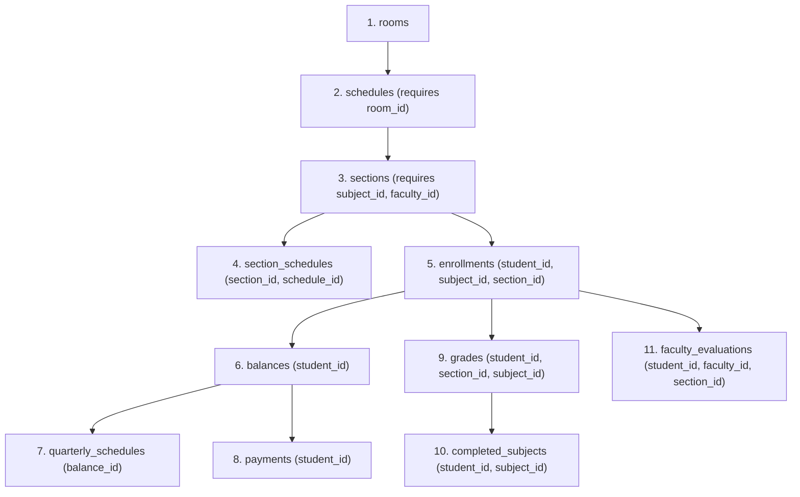

# Database Population Specification & Implementation Guide

This document provides complete instructions, schema definitions, business rules, edge cases, conflict prevention logic, and validation queries for populating the database tables that were cleared in MySQL.

---

## 1. Executive Context & Current Database State

### 1.1 Tables Currently Cleared (0 Records)
The following tables are completely empty and need to be populated in the correct dependency order:
1. `rooms`
2. `schedules`
3. `sections`
4. `section_schedules` (junction table)
5. `enrollments`
6. `balances`
7. `quarterly_schedules` (if quarterly payment plan is used)
8. `payments`
9. `completed_subjects`
10. `grades`
11. `faculty_evaluations`

### 1.2 Tables Already Populated & Intact
Do NOT truncate or recreate these tables. They contain production/seed data:
- `accounts`, `admins`, `faculty`, `students` (user credentials and profiles)
- `courses` (`BSIT`, `BSCS`, `BSIS`, `BSCpE`)
- `subjects` (81 curriculum subjects mapped to course codes and prerequisites)
- `announcements`
- `admissions`
- `enrollment_periods` (Current active period: typically `FIRST` Semester, `2024-2025` or `2025-2026`)
- `grading_periods`

---

## 2. Table Dependency & Insertion Order

To respect Foreign Key (FK) constraints in MySQL, population **MUST** follow this exact sequence:



---

## 3. Schema Definitions & Enums Reference

All UUID IDs are `VARCHAR(36)`. When generating records via SQL, use `UUID()` or explicit static UUID strings.

### 3.1 Relevant Enums
- **`RoomType`**: `LECTURE`, `LABORATORY`
- **`Day`**: `MONDAY`, `TUESDAY`, `WEDNESDAY`, `THURSDAY`, `FRIDAY`, `SATURDAY`, `SUNDAY`
- **`Semester`**: `FIRST`, `SECOND`, `SUMMER`
- **`Status`**: `PENDING`, `ENROLLED`, `DROPPED`
- **`PaymentPlan`**: `FULL`, `QUARTERLY`
- **`PaymentMethod`**: `CASH`, `BANK_TRANSFER`, `CREDIT_CARD`, `GCASH`, `PAYMAYA`
- **`PaymentType`**: `DOWNPAYMENT`, `QUARTERLY`, `FULL`
- **`Quarter`**: `PRELIM`, `MIDTERM`, `PREFINAL`, `FINAL`
- **`QuarterStatus`**: `PAID`, `UNPAID`, `OVERDUE`

---

## 4. Business Rules & Edge Cases to Prevent

### 4.1 Strict Schedule Conflicts (CRITICAL)
In this system, scheduling overlaps cause server exceptions (`IllegalStateException`) and UI errors. You must ensure zero overlaps across 3 distinct dimensions:

1. **Room Conflict**:
   - Two schedules cannot share the same `room_id` on the same `day_of_week` with overlapping start/end times:
     $$\text{Start}_A < \text{End}_B \quad \text{AND} \quad \text{Start}_B < \text{End}_A$$
2. **Faculty Overlap**:
   - A single `faculty_id` cannot be assigned to two sections whose schedules overlap on the same `day_of_week`, regardless of the room.
3. **Student Schedule Clash**:
   - When generating sample enrollments or student schedules, a student cannot be enrolled in multiple sections with overlapping schedules on the same day.

### 4.2 Standard Time Slots (Recommended for Conflict Prevention)
To completely prevent overlaps mathematically, use discrete, non-overlapping standard class blocks:
- **Block 1**: `07:30:00` - `09:00:00` (1.5 hrs)
- **Block 2**: `09:00:00` - `10:30:00` (1.5 hrs)
- **Block 3**: `10:30:00` - `12:00:00` (1.5 hrs)
- **Block 4**: `13:00:00` - `14:30:00` (1.5 hrs)
- **Block 5**: `14:30:00` - `16:00:00` (1.5 hrs)
- **Block 6**: `16:00:00` - `17:30:00` (1.5 hrs)
- **Lab Block A**: `08:00:00` - `11:00:00` (3.0 hrs)
- **Lab Block B**: `13:00:00` - `16:00:00` (3.0 hrs)

Pattern pairs:
- **MW pattern**: Monday & Wednesday (same time block)
- **TTH pattern**: Tuesday & Thursday (same time block)
- **FS pattern**: Friday & Saturday (or single 3-hr lab on Friday)

### 4.3 Subject Code Prefix & Program Eligibility Rules
The academic curriculum partitions subjects according to prefix conventions:
1. **`CSIT` Prefix** (e.g. `CSIT111`, `CSIT121`, `CSIT221`, `CSIT226`, `CSIT227`, `CSIT228`, `CSIT321`):
   - **Common Core Computing**: Open to **both** BSCS and BSIT students.
   - **Database Value**: The `course` column for all `CSIT` subjects MUST be set to `'CSIT'`.
   - A corresponding record in `courses` table with `code = 'CSIT'` ("Common Computer Studies", prefix `'CSIT-C'`) should exist.
2. **`CS` Prefix** (e.g. `CS111`, `CS112`, `CS121`, `CS211`, `CS311`):
   - **Computer Science Specific**: Restrict enrollment strictly to **BSCS students only** (Course = `'BSCS'`).
3. **`IT` Prefix** (e.g. `IT211`, `IT221`, `IT311`, `IT312`, `IT321`):
   - **Information Technology Specific**: Restrict enrollment strictly to **BSIT students only** (Course = `'BSIT'`).
4. **Non-`CS`, `IT`, or `CSIT` Prefixes** (`GEN` / General Education, e.g. `MATH`, `ENGL`, `PHILO`, `NSTP`, `PE`, `HIST`, `STS`, `STAT`):
   - **General Education / Institutional Core**: Open to **any student across all programs**.
   - **Database Value**: The `course` column for all these General Education subjects in the `subjects` table MUST be set to `'GEN'` (NOT `'BSIT'` or `'BSCS'`).
   - A corresponding record in `courses` table with `code = 'GEN'` ("General Education Department", prefix `'GEN-G'`) should exist.

```sql
USE `school_management`;

-- Ensure CSIT and GEN courses exist
INSERT IGNORE INTO courses (id, code, name, section_prefix)
VALUES 
  ('course-csit', 'CSIT', 'Common Computer Studies', 'CSIT-C'),
  ('course-gen', 'GEN', 'General Education Department', 'GEN-G');

-- Align CSIT subjects to 'CSIT'
UPDATE subjects
SET course = 'CSIT'
WHERE subject_code LIKE 'CSIT%';

-- Align General Education subjects to 'GEN'
UPDATE subjects 
SET course = 'GEN' 
WHERE subject_code NOT LIKE 'CS%' 
  AND subject_code NOT LIKE 'IT%';
```

### 4.4 Capacity & Count Constraints
- Room capacity typically ranges between `30` and `50` (or `500` for GYM).
- Section capacity must satisfy: $1 \le \text{Section Capacity} \le \text{Room Capacity}$.
- Section `current_count` must equal the exact number of active (`PENDING` or `ENROLLED`) records in `enrollments` for that `section_id`.

### 4.4 Financial & Billing Rules (`BillingRules`)
- Cost per unit: `1,000.00` PHP.
- Downpayment: `1,000.00` PHP.
- Full Payment Discount: `5%` ($0.05$).
  - Full Plan Total Cost = $\text{Units} \times 1000$.
  - Remaining Balance = $\text{Total Cost} \times 0.95$ (if unpaid) or $0.00$ (if fully paid).
- Quarterly Plan:
  - Downpayment = `1,000.00`.
  - Remaining balance divided across 4 quarters: `PRELIM`, `MIDTERM`, `PREFINAL`, `FINAL`.

### 4.5 Grade Calculation Rules
- Midterm Computed = $(0.40 \times \text{prelim}) + (0.60 \times \text{midterm})$.
- Final Computed = $(0.40 \times \text{pre_final}) + (0.60 \times \text{final})$.
- Overall Grade = $\frac{\text{Midterm Computed} + \text{Final Computed}}{2.0}$.
- Passing Grade: Grade $\ge 75.0$ (or standard Philippine 1.0–3.0 grading scale if stored as raw percentage: $\ge 75.0$).

---

## 5. Step-by-Step Population Instructions

### Step 1: Populate `rooms`
Create a realistic set of Lecture and Computer Laboratory rooms.
```sql
INSERT INTO rooms (id, room_name, capacity, room_type, is_active) VALUES
('room-lec-101', 'Room 101 - Lecture Hall', 45, 'LECTURE', 1),
('room-lec-102', 'Room 102 - Lecture Hall', 45, 'LECTURE', 1),
('room-lec-103', 'Room 103 - Lecture Hall', 40, 'LECTURE', 1),
('room-lab-201', 'Lab 201 - Computer Lab A', 35, 'LABORATORY', 1),
('room-lab-202', 'Lab 202 - Computer Lab B', 35, 'LABORATORY', 1),
('room-lab-203', 'Lab 203 - Networks & Hardware Lab', 30, 'LABORATORY', 1);
```

The room naming convention should follow:
- BuildingCodes: RTL, NGE, GLE
- Building code must be follow by the floor numbers: 1-4 for NGE and RTL and 1-8 for GLE
- RoomsNumber must be after the floor number, it should range from 0 - 10 only
- Example room name format: RTL300 - RTL310
- All NGE Rooms are Laboratory Rooms and can accomodate 45 seats.
- GLE and RTL rooms are all lecture rooms and can accomodate 50 seats.
- Include a GYM building, this will only be the only 1 of it's type, think of it as a single large structure. The GYM can fit 500 seats.


### Step 2: Populate `schedules`
Create non-overlapping time slots referencing the rooms created in Step 1.
- Ensure end time is strictly greater than start time.
- Verify no two schedules share the same `(room_id, day_of_week, startTime, endTime)` overlap.

### Step 3: Populate `sections`
Link existing subjects from `subjects` to faculty members from `faculty`.
- Section codes must follow the curriculum convention (e.g. `IT-G1`, `IT-G2`, `CS-F1`, `CS-F2`).
- Right now the system only have subjects for CS and IT, G code is for IT and F is for CS
- Keep the number for sections low, meaning the number after F or G should only range from 1-10.
- Different schedules accross the week can have the same Section Code as long as they do not overlap each other.
- Check that the assigned faculty is not teaching another section during the same time.
- Set `capacity` (e.g. 40), `current_count` (0 initially or matching enrollments), and `version = 0`.

### Step 4: Populate `section_schedules`
Associate each `section` with 1 or 2 `schedule` slots (e.g., MW or TTH pair).
- Avoid multi-booking: Each schedule slot should belong to only one section.

### Step 5: Populate `enrollments` (Optional Seed)
If seeding active enrollments:
- Match `student_id` (from `students`), `subject_id` (from `subjects`), and `section_id` (from `sections`).
- Ensure `semester` and `school_year` match the active `enrollment_periods`.
- Increment `current_count` in `sections` accordingly.

### Step 6: Populate `balances`, `quarterly_schedules`, and `payments`
- For each enrolled student, calculate `total_cost` based on enrolled units $\times 1000$.
- Insert corresponding `balances` row.
- If payments are simulated, insert into `payments` and deduct from `balances.remaining_balance`.

### Step 7: Populate `grades`, `completed_subjects`, and `faculty_evaluations`
- For completed historical terms, insert into `completed_subjects` (enables prerequisite clearance for upper-year students).
- For active terms, insert grades if simulating midterms/finals.
- Insert faculty evaluations (scores 1–5 for the 5 criteria).

---

## 6. Edge Case Verification SQL Queries

Run these verification queries **immediately after** running the seed script. Every check MUST return `0 rows`.

### Check 1: Room Overlap Conflict
Detects any schedules sharing the same room on the same day with intersecting time ranges:
```sql
SELECT 
    s1.id AS schedule_1,
    s2.id AS schedule_2,
    s1.room_id,
    s1.day_of_week,
    s1.start_time AS s1_start,
    s1.end_time AS s1_end,
    s2.start_time AS s2_start,
    s2.end_time AS s2_end
FROM schedules s1
JOIN schedules s2 
  ON s1.room_id = s2.room_id 
 AND s1.day_of_week = s2.day_of_week
 AND s1.id < s2.id
WHERE s1.start_time < s2.end_time 
  AND s2.start_time < s1.end_time;
-- EXPECTED: 0 rows. If > 0, room double-booking detected!
```

### Check 2: Faculty Overlap Conflict
Detects any faculty member scheduled to teach two different sections at the same time:
```sql
SELECT 
    sec1.faculty_id,
    sec1.id AS section_1,
    sec2.id AS section_2,
    sch1.day_of_week,
    sch1.start_time AS sch1_start,
    sch1.end_time AS sch1_end,
    sch2.start_time AS sch2_start,
    sch2.end_time AS sch2_end
FROM section_schedules ss1
JOIN section_schedules ss2 ON ss1.section_id < ss2.section_id
JOIN sections sec1 ON ss1.section_id = sec1.id
JOIN sections sec2 ON ss2.section_id = sec2.id
JOIN schedules sch1 ON ss1.schedule_id = sch1.id
JOIN schedules sch2 ON ss2.schedule_id = sch2.id
WHERE sec1.faculty_id = sec2.faculty_id
  AND sch1.day_of_week = sch2.day_of_week
  AND sch1.start_time < sch2.end_time
  AND sch2.start_time < sch1.end_time;
-- EXPECTED: 0 rows. If > 0, faculty double-booking detected!
```

### Check 3: Section Capacity Exceeds Room Capacity
Verifies section capacity does not surpass physical room limits:
```sql
SELECT 
    sec.id AS section_id,
    sec.section_code,
    sec.capacity AS section_capacity,
    r.room_name,
    r.capacity AS room_capacity
FROM sections sec
JOIN section_schedules ss ON sec.id = ss.section_id
JOIN schedules sch ON ss.schedule_id = sch.id
JOIN rooms r ON sch.room_id = r.id
WHERE sec.capacity > r.capacity;
-- EXPECTED: 0 rows.
```

### Check 4: Section `current_count` Desynchronization
Verifies section enrollment headcounts match the actual records in `enrollments`:
```sql
SELECT 
    sec.id,
    sec.section_code,
    sec.current_count,
    COUNT(e.id) AS actual_enrolled
FROM sections sec
LEFT JOIN enrollments e ON sec.id = e.section_id AND e.status IN ('PENDING', 'ENROLLED')
GROUP BY sec.id, sec.section_code, sec.current_count
HAVING sec.current_count != actual_enrolled;
-- EXPECTED: 0 rows.
```

### Check 5: Student Schedule Collision (Same Day / Time)
Verifies that no student is enrolled in two overlapping classes:
```sql
SELECT 
    e1.student_id,
    sec1.section_code AS section_1,
    sec2.section_code AS section_2,
    sch1.day_of_week,
    sch1.start_time AS s1_start,
    sch1.end_time AS s1_end,
    sch2.start_time AS s2_start,
    sch2.end_time AS s2_end
FROM enrollments e1
JOIN enrollments e2 ON e1.student_id = e2.student_id AND e1.id < e2.id
JOIN section_schedules ss1 ON e1.section_id = ss1.section_id
JOIN section_schedules ss2 ON e2.section_id = ss2.section_id
JOIN schedules sch1 ON ss1.schedule_id = sch1.id
JOIN schedules sch2 ON ss2.schedule_id = sch2.id
WHERE e1.status IN ('PENDING', 'ENROLLED')
  AND e2.status IN ('PENDING', 'ENROLLED')
  AND sch1.day_of_week = sch2.day_of_week
  AND sch1.start_time < sch2.end_time
  AND sch2.start_time < sch1.end_time;
-- EXPECTED: 0 rows.
```

---

## 7. Deliverable Expectations for the Executing Agent

When executing the population task:
1. **Idempotency / Safety**: Use `INSERT INTO ...` with explicit IDs or `INSERT IGNORE` / `ON DUPLICATE KEY UPDATE` to avoid partial failure.
2. **Transaction Scope**: Wrap operations inside `START TRANSACTION;` and `COMMIT;`.
3. **Execution of Verification Queries**: The executing agent must execute the verification queries in Section 6 and confirm all return 0 rows before concluding.

