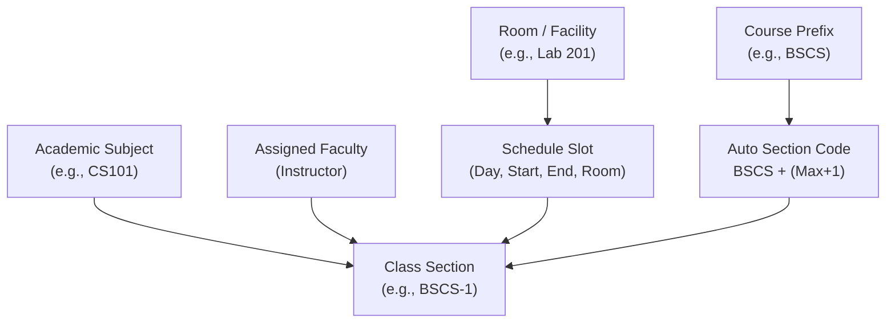

# Flow of Creating a Section: Admin Class Schedules Page

This document provides a comprehensive end-to-end explanation of how a **Class Section** is created in the **School Management System**, specifically focusing on the **Admin User Portal &rarr; Class Schedules Page** (`AdminSchedulesPage.jsx`) and its underlying backend processing (`SectionService.java`, `SectionController.java`).

---

## 1. High-Level Architecture & Core Entities

Creating a section is not just inserting a record; it coordinates four interdependent domains:



### Core Entities Involved:
1. **`Subject`**: Defines the subject code, title, units, and the course it belongs to. Crucially, each subject maintains an `assignedFaculties` list.
2. **`Faculty`**: The instructor assigned to teach the section. **Strict rule:** Only faculty assigned to that specific subject on the Academic Subjects page can be assigned to the section.
3. **`Room`**: Physical lecture hall or laboratory with defined capacity and building location.
4. **`Schedule`**: Represents an active weekly time slot on a specific `day_of_week` (`MONDAY`–`SUNDAY`) from `startTime` to `endTime` in a designated `Room`.
5. **`Section`**: The scheduled class offering containing the section code, subject reference, faculty reference, total student capacity, current enrollment count (`currentCount = 0`), and associated schedule slots.

---

## 2. End-to-End Workflow Diagram

```mermaid
sequenceDiagram
    autonumber
    actor Admin as Admin User
    participant UI as Class Schedules Page (AdminSchedulesPage.jsx)
    participant API as SectionController / SectionService
    participant DB as MySQL Database

    Admin->>UI: Navigates to Class Schedules Page
    UI->>API: GET /schedules, /rooms, /sections, /subjects, /faculty
    API-->>UI: Populates Timetable Grid & Directory

    alt Option A: Direct Button Click
        Admin->>UI: Clicks "+ Create Section" button
    else Option B: Interactive Drag on Timetable Grid
        Admin->>UI: Selects Room, clicks & drags mouse down time slots (e.g., Mon 8:00–10:00 AM)
        UI->>UI: Pre-fills Day, Time Range & Room automatically
    end

    UI->>Admin: Opens "Create Class Section" Modal
    Admin->>UI: Selects Subject (e.g., CS101)
    UI->>UI: Filters Faculty dropdown (only instructors assigned to CS101)
    Admin->>UI: Selects Faculty & sets Section Capacity
    UI->>UI: Live conflict check: highlights in orange/red if faculty is double-booked
    Admin->>UI: Submits Form

    UI->>API: POST /sections (payload with subjectCode, facultyId, capacity, schedules[])
    
    rect rgb(240, 248, 255)
        note over API,DB: Backend Validation & Conflict Engine
        API->>DB: Verify Faculty is assigned to teach Subject
        API->>DB: Verify Section Capacity <= Room Capacity for all slots
        API->>DB: Check Room Clashes (same room, overlapping time slot)
        API->>DB: Check Faculty Double-Booking (faculty teaching elsewhere at same time)
        API->>DB: Auto-generate Section Code: Prefix + (Max Suffix + 1)
        API->>DB: Save Schedules & Section atomically (@Transactional)
    end

    API-->>UI: 200 OK (Returns created SectionDto)
    UI->>UI: Trigger sections.reload() & schedules.reload()
    UI->>Admin: Shows success notification; renders new block on weekly timetable
```

---

## 3. Frontend Interaction Flow (`AdminSchedulesPage.jsx`)

The Class Schedules page offers an intuitive visual interface for schedule management.

### 3.1 Two Entry Points to Create a Section

1. **Direct Header Action**:
   - The Admin clicks the **`+ Create Section`** button located at the top right of the page header.
   - Opens the modal with default values (`Monday 08:00–10:00 AM`, default capacity 35).

2. **Interactive Drag-to-Select on the Room Timetable (Recommended UX)**:
   - The Admin switches to the **Room Weekly Timetable** view (`TIMETABLE` mode).
   - Selects a target room from the room selector (e.g., `Lab 302 - Main Building`).
   - The Admin clicks down on an unoccupied 30-minute time cell (e.g., `Wednesday 13:00`) and drags downward to `15:00`.
   - **Safeguards built into the grid**:
     - Dragging over already occupied time slots is strictly blocked (`isSlotOccupied`).
     - Shift-clicking allows selecting a contiguous block without mouse dragging.
     - Ctrl-click is disabled to prevent non-contiguous gaps.
   - On mouse release, the modal opens **automatically pre-filled** with:
     - `Day`: `WEDNESDAY`
     - `Start Time`: `13:00`
     - `End Time`: `15:00`
     - `Room`: `Lab 302`

---

### 3.2 Modal Configuration & Live Client Validations

Inside the **Create Class Section Modal**, the Admin completes four fields:

```
┌─────────────────────────────────────────────────────────────┐
│  Create Class Section                                   [X] │
├─────────────────────────────────────────────────────────────┤
│  Subject Code:                                              │
│  [ Select Academic Subject  (e.g., CS101 - Intro to CS)  v] │
│                                                             │
│  Faculty / Instructor:                                      │
│  [ Select Faculty (Filtered: Only eligible instructors)   v]│
│  ⚠ Warning: Conflict detected if faculty busy elsewhere    │
│                                                             │
│  Class Capacity: [ 35 ]                                     │
│                                                             │
│  Weekly Class Schedules:                                    │
│  ┌────────────────────────────────────────────────────────┐ │
│  │ Slot 1: [ WEDNESDAY v ] [ 13:00 ] to [ 15:00 ]         │ │
│  │ Room: [ Lab 302 - Main Building                      v]│ │
│  └────────────────────────────────────────────────────────┘ │
│  [ + Add Another Schedule Slot ]                            │
├─────────────────────────────────────────────────────────────┤
│                                  [ Cancel ]  [ Save Section ]│
└─────────────────────────────────────────────────────────────┘
```

#### Client-Side Validation Rules:
1. **Dynamic Faculty Filtering**:
   - When a subject is selected, `eligibleFacultyList` computes which instructors are formally assigned to teach that subject on the Academic Subjects management page.
   - If no faculty are assigned to that subject, a warning message appears:
     > *"No faculty members are assigned to teach this subject. Please assign faculty on the Academic Subjects page first."*
2. **Client-Side Conflict Detection (`getFacultyConflictInfo`)**:
   - As soon as a faculty member is selected, the browser immediately iterates through all existing sections across the university to check if that instructor is already booked for any of the proposed time slots.
   - If a clash is found, a warning box appears with details:
     > *"Conflict: Already teaching IT-G2 (CS105) on WEDNESDAY 13:00–15:00 in Room 101."*
3. **Multi-Slot Support**:
   - A section can have split weekly schedules (e.g., Lecture on Monday 08:00–10:00 in Room 101, and Lab on Thursday 08:00–10:00 in Lab 201).
   - Additional slots can be added via `[ + Add Another Schedule Slot ]`.
4. **Time Sanity Check**:
   - Start time must precede end time (`startTime < endTime`).
   - Every schedule slot must have an assigned room.

---

## 4. Backend Processing Flow (`SectionService.java`)

When the Admin clicks **Save Section**, a `POST /sections` request is dispatched to [`SectionController.java`](file:///c:/Users/Marion%20Alfeche/SchoolManagementSystem/backend/src/main/java/com/schoolsystem/controller/SectionController.java) and processed by [`SectionService.createSection()`](file:///c:/Users/Marion%20Alfeche/SchoolManagementSystem/backend/src/main/java/com/schoolsystem/service/SectionService.java#L55-L90).

The service executes the following atomic steps within a database transaction (`@Transactional`):

### 4.1 Step 1: Strict Faculty Qualification Check
```java
if (subject.getAssignedFaculties() == null || 
    subject.getAssignedFaculties().stream().noneMatch(f -> f.getId().equals(facultyId))) {
    throw new IllegalStateException("Faculty " + faculty.getName() + 
        " is not assigned to teach subject " + subjectCode + 
        ". Please assign them on the Academic Subjects page first.");
}
```
Prevents assigning unauthorized instructors to subjects they are not certified or assigned to teach.

### 4.2 Step 2: Room Capacity Boundary Check
For each candidate schedule slot:
```java
Room room = roomRepository.findById(slot.roomId())
        .orElseThrow(() -> new NotFoundException("Room not found"));

if (capacity > room.getCapacity()) {
    throw new IllegalArgumentException(
        "Section capacity (" + capacity + ") exceeds the capacity of room "
        + room.getRoomName() + " (" + room.getCapacity() + ")");
}
```
Ensures class enrollment limits never exceed physical room seating.

### 4.3 Step 3: Two-Tier Conflict Detection Engine (`checkConflicts`)
The service checks candidate time slots against the entire schedule database:

1. **Room Clash Check**:
   - Checks if the requested room is already booked by another section on the same day and overlapping time.
   ```java
   if (candidate.hasConflict(existing)) {
       throw new IllegalStateException("Room conflict on " + candidate.getDay() + " "
               + candidate.getStartTime() + "–" + candidate.getEndTime()
               + ": room already booked");
   }
   ```
2. **Faculty Double-Booking Clash Check**:
   - Checks if the faculty member is scheduled to teach another section at the same time, **regardless of the room**:
   ```java
   if (candidate.overlapsWith(existing)) {
       throw new IllegalStateException("Faculty conflict on " + candidate.getDay() + " "
               + candidate.getStartTime() + "–" + candidate.getEndTime()
               + ": faculty already assigned to another section");
   }
   ```

### 4.4 Step 4: Automatic Section Code Generation (`generateSectionCode`)
Section codes are automatically assigned by the system to avoid duplicates and human error:
1. Reads the `Course` associated with the subject (e.g. `BSCS`).
2. Retrieves the section prefix from `course.getSectionPrefix()` (or defaults to `prefix = courseCode + "-"`).
3. Queries existing sections starting with that prefix (`findBySectionCodeStartingWith(prefix)`).
4. Extracts the highest numeric suffix in use (`max`) and increments it by 1:
   $$\text{Section Code} = \text{prefix} + (\max + 1)$$
   *Example: If `BSCS-1` and `BSCS-2` exist, the new section is automatically named `BSCS-3`.*

### 4.5 Step 5: Transactional Atomic Persistence
1. Saves all candidate `Schedule` entities to the `schedules` table.
2. Creates the `Section` entity with `currentCount = 0` and links the schedules.
3. Saves the `Section` entity, writing associations into the `section_schedules` join table.
4. Returns the created `SectionDto` back to the frontend.

---

## 5. Post-Creation UI State Synchronization

Upon receiving HTTP 200 OK:
1. **Modal Closes**: `setSectionModalOpen(false)` and drag highlight is cleared (`setSelection(null)`).
2. **Live Data Refresh**:
   - `sections.reload()` updates the section directory and section counts.
   - `schedules.reload()` updates the room timetable grid.
3. **Instant Visual Feedback**:
   - A success banner appears: `"Section BSCS-3 created successfully!"`.
   - On the **Timetable Grid**, a colored schedule block immediately occupies the selected day and time range.
   - On the **Class Directory** table, the new section appears with `0 / 35` students enrolled, ready for student enrollment and attendance tracking.

---

## 6. Summary Comparison Table

| Stage | Where Handled | Rules & Validations Enforced |
|---|---|---|
| **Entry Point** | Frontend (`AdminSchedulesPage.jsx`) | Direct button click or interactive drag on room grid (auto-populates Day, Time, Room). |
| **Faculty Selection** | Frontend (`eligibleFacultyList`) & Backend (`SectionService`) | Only faculty assigned to the subject can be selected. Server throws 409 if bypassed. |
| **Faculty Clash** | Frontend (`getFacultyConflictInfo`) & Backend (`overlapsWith`) | Faculty cannot teach two classes simultaneously in different or same rooms. |
| **Room Clash** | Frontend (`isSlotOccupied`) & Backend (`hasConflict`) | Room cannot be double-booked during overlapping time windows. |
| **Capacity** | Backend (`buildCandidates`) | Section capacity must be $\le$ physical room capacity. |
| **Section Code** | Backend (`generateSectionCode`) | Course prefix + $(\max(\text{suffix}) + 1)$ ensures contiguous, collision-free codes. |
| **Persistence** | Backend (`@Transactional`) | Atomic insert across `schedules`, `sections`, and `section_schedules`. |

